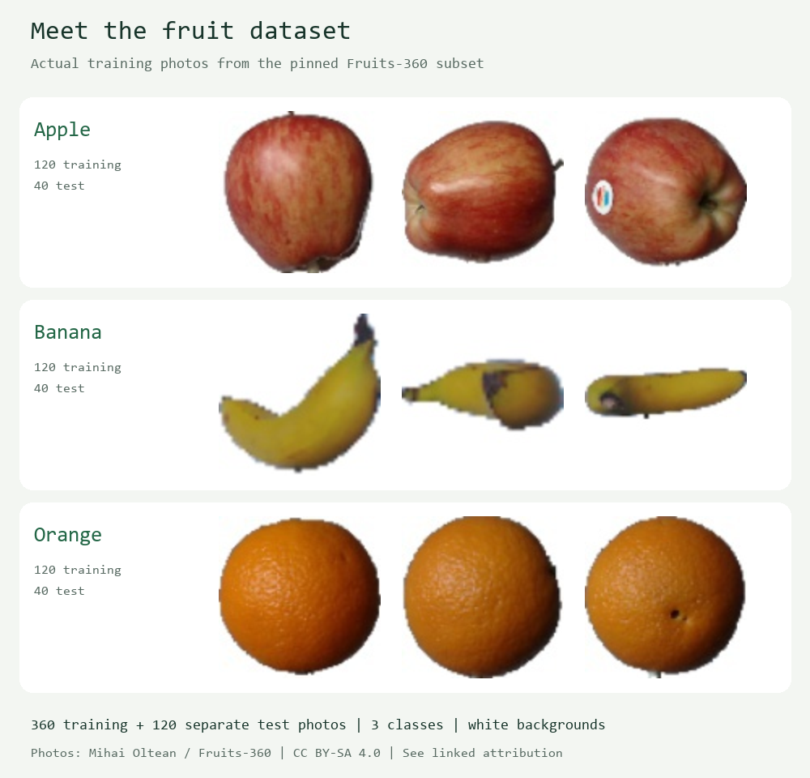

# ExecuTorch for MIT App Inventor

A community Android extension for running a local machine learning model from
App Inventor blocks. The example app classifies a photo as **apple, banana or orange**.
It uses your phone's processor to run a PyTorch ExecuTorch model; classification
does not send the photo to a server.

You can try the supplied pretrained model without installing Python or training
anything. The extension, model, photos and blocks are all included in one project file.

## Where to go next

| If you want to | Read |
| --- | --- |
| Try the fruit app on your phone | This page |
| Understand what the app is doing | [Learning guide](docs/learning-guide.md) |
| Train the fruit model yourself or replace it with your own | [Training and export](docs/training-and-export.md) |
| See every block and its parameters | [Block reference](docs/blocks.md) |
| Add the extension to your own App Inventor project | [Use your own model](#next-step-use-your-own-model) below |
| Build, test, release or change the extension | [Developer guide](docs/developer-guide.md) |

## What to download

You need an App Inventor account, a computer with a browser and a 64-bit Android
phone running Android 8 or later.

| File | What it is | When you need it |
| --- | --- | --- |
| [ExecuTorchFruit.aia](examples/ExecuTorchFruit.aia) | Editable App Inventor project with the extension and model | Start here; download the raw file from GitHub |
| `.apk` | Installable Android app | Build from the project to test on your phone |
| `ExecuTorch-ARM64.aix` | Extension that adds ExecuTorch blocks | For your own project; not needed separately for the sample. Get it from [Releases](https://github.com/eoinjordan/appinventor-executorch-extension/releases) |
| `ExecuTorch-multi-ABI.aix` | Larger extension that also supports x86_64 emulators | Only for an emulator |
| `.pte` | Exported model that ExecuTorch runs | Already included as `fruit_classifier.pte` (about 39 KB) |

A release contains the code at its tag, so it can be older than the example in this repository.

## Try your first prediction

1. Open [MIT App Inventor](https://ai2.appinventor.mit.edu/) and sign in.
2. Import `examples/ExecuTorchFruit.aia` using **Projects > Import project (.aia) from my computer**. Give it a new project name if you imported an older version.
3. Explore **Designer** to see the screen, then **Blocks** to see how it works.
4. Choose **Build > Android App (.apk)**. Transfer the APK to your phone, install it and open it. Use a compiled APK; a 32-bit Companion process cannot load the runtime.
5. Wait for the result card to say **Ready**. The app loads `fruit_classifier.pte` automatically.
6. Under **Step 1**, tap **Apple**, **Banana** or **Orange**. The prediction should match the selected photo. These buttons classify supplied examples; they do not train the model.
7. Under **Step 2**, try **Choose photo** or **Take photo**. Use one centred fruit on a plain white background. Allow camera/photo access when Android asks.
8. Turn on airplane mode and tap a sample again. Classification still works because the model runs on the phone.

The result card shows the label, the three class scores and the time inference took on
the phone. **What is running on this phone** shows the loaded model file, the ExecuTorch
runtime version and what the model can and cannot see. **Learn more** opens MIT's App
Inventor tutorials, PyTorch's beginner course, the ExecuTorch documentation and this
project's guide; those pages need internet access.

If loading fails, the photo controls stay disabled and the original error appears with
**Retry loading fruit model**. If retry fails, report that loading error.

## The dataset

| Label | Training photos | Separate test photos |
| --- | ---: | ---: |
| Apple | 120 | 40 |
| Banana | 120 | 40 |
| Orange | 120 | 40 |
| **Total** | **360** | **120** |

Examples from our Fruits-360 subset, photographed on white backgrounds. The grid shows
training photos; testing uses separate images. Photos: Mihai Oltean / Fruits-360,
CC BY-SA 4.0. Resized and labelled; [attribution](models/FRUIT_DATASET.md) and
[source records](docs/images/fruit-dataset-sources.json).

**Image classification** assigns a label to a whole image. This app chooses among three
labels; it does not locate multiple objects or draw boxes around them. The model has no
"unknown" class, so a pear or an empty table still gets one of the three labels. The
[learning guide](docs/learning-guide.md) explains the terms and has experiments to try.

## How the blocks work

| Block or event | What it does |
| --- | --- |
| `Screen.Initialize` | Calls `LoadModel("fruit_classifier.pte")` |
| `ModelLoaded(assetName)` | Enables the sample and photo controls and fills in the model name |
| `RunImage(imagePath, 32)` | Resizes the photo to 32 by 32 pixels, converts it to numbers and runs the model |
| `InferenceCompleted(values, shape, elapsedMs)` | Returns three scores; the app displays the highest-scoring label |
| `ErrorOccurred(operation, message)` | Supplies the operation and the original error if a step fails |

Scores arrive in **apple, banana, orange** order, which is positions **1, 2, 3** in an
App Inventor list. That order belongs to this model; your own model defines its own.
Loading and inference finish asynchronously: use their completion events before
starting the next step. The [block reference](docs/blocks.md) shows every block with a
picture and a table of its parameters.

## Next step: use your own model

The [training and export guide](docs/training-and-export.md) has copyable PowerShell
and terminal commands, recorded command output, and an explanation of each
hyperparameter. These steps are optional; the supplied app already includes its model.
Once you have a new `fruit_classifier.pte`, replace the one in the project's **Media**,
rebuild the APK and test all three samples. Keep size 32 and the same label order.

To add the extension to a different project:

1. Import `ExecuTorch-ARM64.aix` through **Extensions > Import extension**.
2. Drag **ExecuTorch** onto the screen. It is a non-visible component.
3. Upload your `.pte` to **Media**.
4. Call `LoadModel` with the exact asset filename. Enable your inference button only after `ModelLoaded`.
5. For an image model that matches the contract, call `RunImage(imagePath, size)`. For any
   other model, call `RunModel(values, shape)` with a flat list and matching dimensions.
6. Handle `InferenceCompleted` and `ErrorOccurred`.

Your model must be exported with ExecuTorch **1.5.1** and take one float32 tensor in and
one float32 tensor out. The full contract is in the
[developer guide](docs/developer-guide.md#deliberately-small-model-contract) and each
block's parameters are in the [block reference](docs/blocks.md).

## If it does not run

| Symptom | What to check |
| --- | --- |
| **Upload Error** | Import an `.aia` through the project importer and an `.aix` through the extension importer. On a phone use the ARM64 extension |
| **Model unavailable** | Read the original loading message, then tap **Retry loading fruit model** |
| **Load a model first** | Use the current sample and wait for `ModelLoaded` |
| `libfbjni.so` or linker namespace error | Use extension version 3 or newer, rebuild the APK and fully close the previous app before retesting |
| `join` receives `*nothing*` | Replace the older sample project; event variables must be named `message`, not `get message` |
| Unexpected prediction | Test a bundled photo first, then check lighting, background, fruit variety and, for your own model, the class order |

When reporting a problem, include the complete error, the Android version, the sample or
extension version, and whether you used an APK or the Companion.

## Learn more

- **New to App Inventor:** [MIT's beginner tutorials](https://appinventor.mit.edu/explore/ai2/tutorials) introduce screens, components and blocks.
- **Classification with blocks:** [Introduction to Machine Learning: Image Classification](https://appinventor.mit.edu/explore/resources/ai/image-classification-look-extension) provides beginner activities and teaching materials. It uses MIT's Look extension, so its blocks differ from this project.
- **ML with Python:** [PyTorch: Learn the Basics](https://docs.pytorch.org/tutorials/beginner/basics/intro.html) walks through data, models and training.
- **Deploy on a phone:** [ExecuTorch documentation](https://docs.pytorch.org/executorch/stable/index.html) explains the runtime and model deployment. This extension uses **1.5.1**.
- [Earlier screenshots](docs/screenshots.md) of the project.

## For supporters

The [developer guide](docs/developer-guide.md) covers the source files, the build and
release process, native packaging, the model contract and the checks CI runs.

Code is Apache-2.0; see [LICENSE](LICENSE). The fruit photos, dataset subset and the
model trained from them are CC BY-SA 4.0 with attribution to Mihai Oltean / Fruits-360.
Keep those notices when sharing a modified app. See
[THIRD_PARTY_NOTICES.md](THIRD_PARTY_NOTICES.md) and [models/FRUIT_DATASET.md](models/FRUIT_DATASET.md).

Built from [MIT's extension template](https://github.com/mit-cml/extension-template) and
[ExecuTorch's Android API](https://docs.pytorch.org/executorch/stable/using-executorch-android.html).
