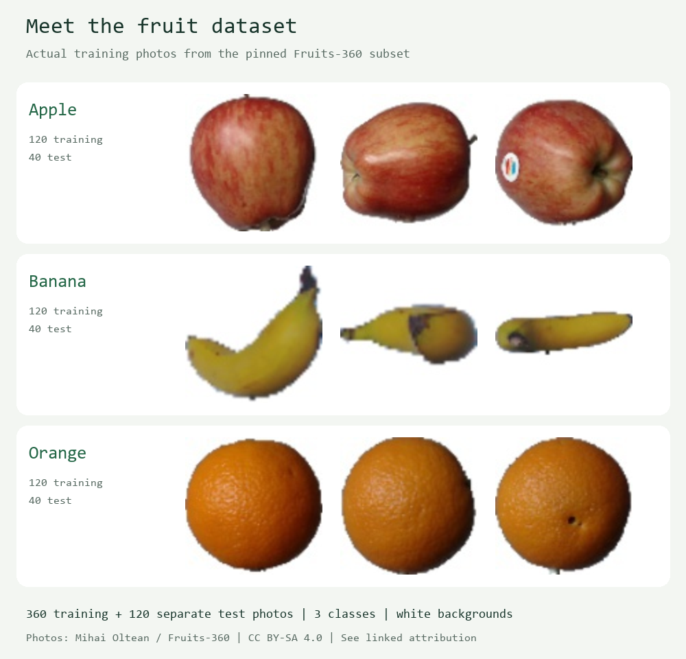

# ExecuTorch for MIT App Inventor

A community Android extension for running a local machine learning model from
App Inventor blocks. The example app classifies a photo as **apple, banana or orange**.
It uses your phone's processor to run a PyTorch ExecuTorch model; classification
does not send the photo to a server.

You can try the supplied pretrained model without installing Python or training
anything. This is a community project, not an official MIT or PyTorch extension.
Native Android inference and camera/gallery flows still need device verification.

## Get the ready-made app project

- [ExecuTorchFruit.aia](../../examples/ExecuTorchFruit.aia): the editable project,
  with the extension, trained model, three test photos and all blocks included.
  On GitHub, use **Download raw file** to save the `.aia`.
- [Release downloads](https://github.com/eoinjordan/appinventor-executorch-extension/releases):
  published `.aix` extensions and `.aia` examples. A release contains the code at its
  tag; it can be older than the current repository example.

| Requirement | Supported starting point |
| --- | --- |
| Phone | Android 8 or later, running a 64-bit app process |
| Phone extension | ARM64 `.aix` |
| Emulator extension | Multi-ABI `.aix` adds x86_64 support |
| Model runtime | ExecuTorch 1.5.1 |
| First test | Build and install an APK; a 32-bit Companion process is unsupported |

An `.aia` is a project you edit. An `.aix` adds extension blocks. An `.apk` is the
app you install. A `.pte` is the model file. The sample `.aia` already contains
the `.aix` and `.pte`; you do not import them separately for the example.

## Import, build and try it

1. Sign in to [MIT App Inventor](https://ai2.appinventor.mit.edu/).
2. Select **Projects → Import project (.aia) from my computer** and choose
   `ExecuTorchFruit.aia`. Give it a new name if you imported an earlier version.
3. In **Designer**, explore the screen and the non-visible `ExecuTorch1` component.
   Open **Blocks** to see the model-loading and classification events.
4. Select **Build → Android App (.apk)**. Transfer the APK to your phone and install it.
5. Open the app and wait for **Ready**. The bundled model loads automatically.
6. Under **Sample photos**, tap **Apple**, **Banana** and **Orange**. Each prediction
   should match the displayed sample photo. These buttons test the model; they do not train it.
7. Try **Choose photo** or **Take photo**, allowing access when Android asks.
   Start with one centred fruit on a plain white background.
8. After the model loads, try a bundled sample in airplane mode. Classification
   should still run; the learning links need internet access.

The app shows the selected label, three class scores and inference time. A score
is not a guarantee of correctness: this model always chooses among its three classes.

## See the dataset

The grid shows nine actual training photos from the pinned Fruits-360 subset.
Training uses 360 photos; testing uses 120 separate photos. Only three test photos
are bundled in the app. Photos: Mihai Oltean / Fruits-360, CC BY-SA 4.0.
The contact sheet is resized and labelled; see [source attribution](../../models/FRUIT_DATASET.md)
and the [nine source records](../images/fruit-dataset-sources.json).

This is image classification: one label for the whole photo. It does not detect
multiple fruits or draw object boxes. Different fruit varieties, cluttered
backgrounds or unrelated objects may produce confident but wrong labels.

## How the blocks work

| Block or event | Role in the example |
| --- | --- |
| `Screen.Initialize` | Calls `LoadModel("fruit_classifier.pte")` |
| `ModelLoaded(assetName)` | Enables the photo controls after successful loading |
| `RunImage(imagePath, 32)` | Converts a photo to the image tensor and runs inference |
| `InferenceCompleted(values, shape, elapsedMs)` | Returns three scores; the app displays the highest-scoring label |
| `ErrorOccurred(operation, message)` | Displays the failed operation and original error |

The fruit score order is **apple, banana, orange**. App Inventor lists use positions
**1, 2, 3**. That order belongs to this model, not to every model supported by the extension.

The image helper supplies RGB float32 values in `[0,1]`, shaped `[1,3,32,32]`.
The remaining normalization is inside this PTE. Wait for completion before sending
another image; model work runs in the background and events update the app screen.

## Use the extension in another project

1. Create an App Inventor project and import `ExecuTorch-ARM64.aix` through
   **Extensions → Import extension**.
2. Drag **ExecuTorch** onto the screen, creating a non-visible component.
3. Upload a compatible `.pte` to the project's **Media** assets.
4. Call `LoadModel` with its exact asset filename. Enable your inference button
   only after `ModelLoaded`.
5. For a compatible image model, call `RunImage(imagePath, size)`. For a numeric
   model, call `RunModel(values, shape)` with a flat list and matching dimensions.
6. Handle `InferenceCompleted` and `ErrorOccurred` so users can see results and errors.

The full API has four functions: `LoadModel`, `RunImage`, `RunModel` and
`UnloadModel`. Events are `ModelLoaded`, `InferenceCompleted`, `ErrorOccurred` and
`ModelUnloaded`. Numeric tensors must have one float32 input and one float32 output;
export with the matching ExecuTorch 1.5.1 runtime and supported operators.

## Replace the fruit model with your own copy

Follow the [training and PTE export guide](../training-and-export.md), which includes
PowerShell/terminal commands, GIFs, dataset counts and hyperparameter documentation.
Then replace `fruit_classifier.pte` in the sample project's Media assets and rebuild
the APK. Keep size 32 and the same label order for this fruit recipe.

Changing classes, tensor shape or preprocessing also requires updating the blocks
and labels to match your model's contract. Training on the computer and running
inference on the phone are separate steps.

## If it does not run

| Symptom | What to check |
| --- | --- |
| Upload Error | Use the `.aia` project importer or `.aix` extension importer as appropriate; prefer the smaller ARM64 extension on a phone |
| Model unavailable | Read the original loading message and try **Retry loading fruit model**; classification stays disabled until loading succeeds |
| Load a model first | Use the current sample and wait for `ModelLoaded`; do not enable inference after a failed load |
| `libfbjni.so` / linker namespace error | Use extension version 3 or newer, rebuild the APK and fully close the previous process before retesting |
| `join` receives `*nothing*` | Update the older sample; event variables must refer to names such as `message`, not `get message` |
| Unexpected prediction | Test a bundled photo first, then check lighting, background, fruit variety and your model's class order |

When reporting a problem, include the complete error, Android version, sample or
extension version, and whether you used an APK or Companion. Successful repository
checks do not replace testing the generated app on a phone.

## Learn more and share

- [MIT beginner App Inventor tutorials](https://appinventor.mit.edu/explore/ai2/tutorials)
- [MIT introduction to image classification](https://appinventor.mit.edu/explore/resources/ai/image-classification-look-extension)
  — teaches classification using a different extension.
- [PyTorch: Learn the Basics](https://docs.pytorch.org/tutorials/beginner/basics/intro.html)
- [ExecuTorch documentation](https://docs.pytorch.org/executorch/stable/index.html)
- [Source code, releases and issues](https://github.com/eoinjordan/appinventor-executorch-extension)

Code is Apache-2.0. Fruit images, dataset and derived model use CC BY-SA 4.0 with
the attribution above. Keep those notices when sharing a modified sample app.
See the [license](../../LICENSE) and [third-party notices](../../THIRD_PARTY_NOTICES.md).
