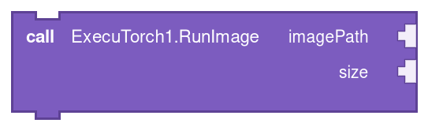
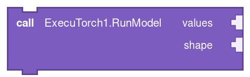
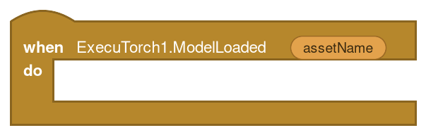
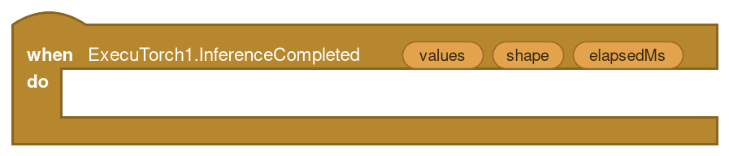
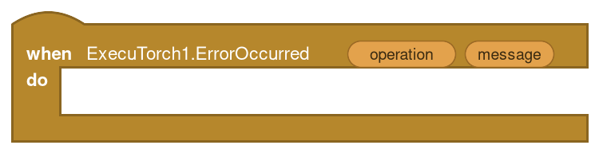
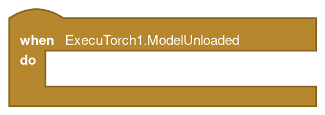
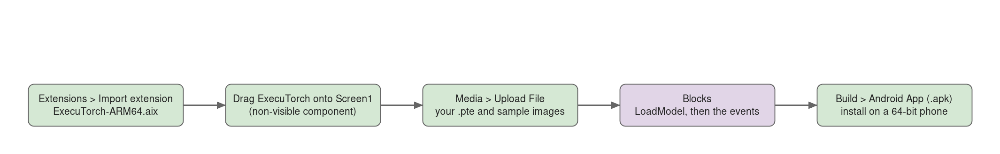
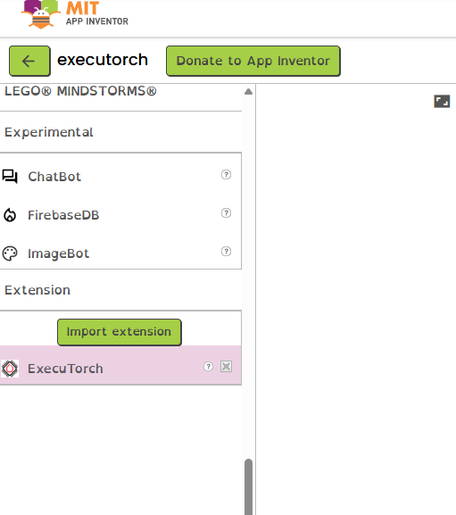
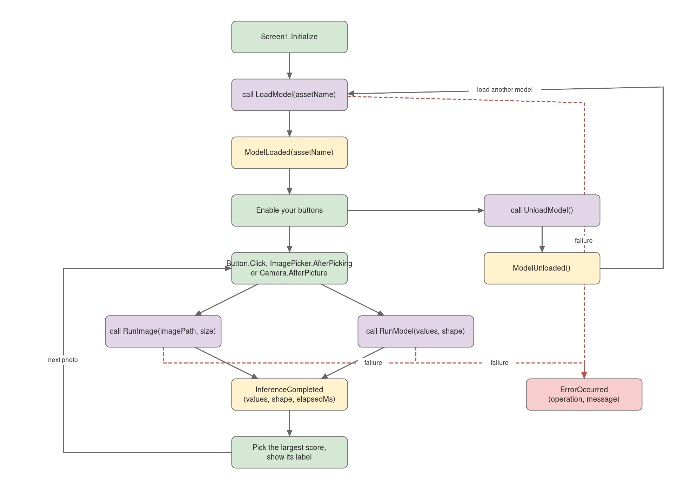
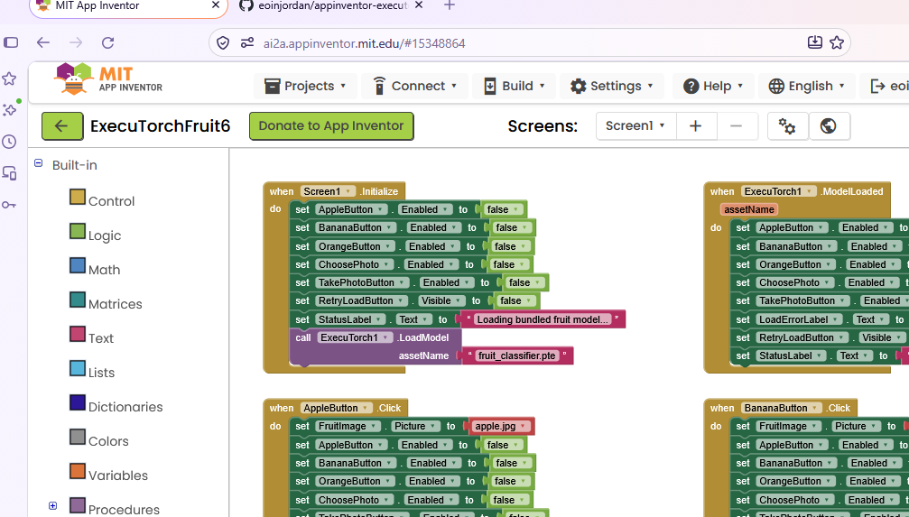

# Block reference

Every block the ExecuTorch component adds to App Inventor (extension version 4). The pictures and tables are generated from the built extension by `python scripts/make_block_reference.py`; edit the Java source or that script, not this page.

Run a custom ExecuTorch 1.5.1 PTE model. One float32 tensor input and output. Android 8+, 64-bit process.

Drag **ExecuTorch** from the Extension drawer onto the screen; it appears as a non-visible component. In the Blocks editor, click `ExecuTorch1` to find the blocks below. The purple blocks are calls you make; the gold blocks are events that run when the extension has something to report.

## Calls

### LoadModel


Load a .pte project asset. Replaces the previous model only after loading succeeds. Export with ExecuTorch 1.5.1.

| Parameter | Type | Meaning |
| --- | --- | --- |
| `assetName` | text | Exact filename of the `.pte` in the project Media, for example `fruit_classifier.pte`. |

Call once, usually in `Screen.Initialize`. Wait for `ModelLoaded` before running anything. If loading fails you get `ErrorOccurred` with operation `LoadModel`, and the previous model, if any, stays loaded.

### RunImage



Run a project image asset or image-picker path. Stretch-resize to size x size and pass RGB float32 NCHW values in [0,1]. Use a model exported for this exact input contract, such as the bundled fruit model. Returns InferenceCompleted.

| Parameter | Type | Meaning |
| --- | --- | --- |
| `imagePath` | text | A Media asset name (`apple.jpg`), an ImagePicker `Selection`, or the `image` path from `Camera.AfterPicture`. |
| `size` | number | Side length in pixels. The photo is stretched to `size × size`; the fruit model uses 32. |

For image models that take RGB float32 NCHW input in `[0, 1]`. Any further normalization must be inside the model. Finishes with `InferenceCompleted` or `ErrorOccurred`.

### RunModel



Run forward with a flat float32 values list and an integer shape list. Returns one float32 tensor; wait for InferenceCompleted before submitting another frame.

| Parameter | Type | Meaning |
| --- | --- | --- |
| `values` | list | Flat list of numbers in row-major order. For a `[1, 4]` tensor, four numbers. |
| `shape` | list | List of positive whole numbers whose product equals the length of `values`. An empty list means a single scalar. |

For any model that takes one float32 tensor. Finishes with `InferenceCompleted` or `ErrorOccurred`. Wait for the result before sending the next call; the queue holds four.

### UnloadModel


Release the current model's native memory.

No parameters.

Frees the native memory. Raises `ModelUnloaded`. Call `LoadModel` again before the next inference.

## Events

### ModelLoaded



The model's forward method is ready.

| Parameter | Type | Meaning |
| --- | --- | --- |
| `assetName` | text | The filename that was loaded. The fruit app shows it on screen. |

Use the parameter blocks by name (`message`, not `get message`) inside the event.

Enable your inference buttons here.

### InferenceCompleted



Flat float32 output values, output shape, and inference duration in milliseconds.

| Parameter | Type | Meaning |
| --- | --- | --- |
| `values` | list | Flat list of float32 outputs. For the fruit model: three scores in apple, banana, orange order (list positions 1, 2, 3). |
| `shape` | list | Shape of the output tensor, for example `[1, 3]`. |
| `elapsedMs` | number | Inference time in milliseconds, measured on the phone. |

Use the parameter blocks by name (`message`, not `get message`) inside the event.

Read scores with the `select list item` block. Scores are probabilities only if the model ends in softmax, as the fruit model does.

### ErrorOccurred



A load, input, inference, or native-library error.

| Parameter | Type | Meaning |
| --- | --- | --- |
| `operation` | text | Which block failed: `LoadModel`, `RunImage`, `RunModel` or `UnloadModel`. |
| `message` | text | The original error text from the extension or the native runtime. Include it when reporting a problem. |

Use the parameter blocks by name (`message`, not `get message`) inside the event.

Show `message` to the user. The fruit app treats a `LoadModel` error specially: it disables the photo controls and offers a retry.

### ModelUnloaded



The current model has been released.

No parameters.

The model has been released; inference calls will fail until you load one.

## Adding the extension to a project





## Which blocks each use case needs

| Use case | ExecuTorch blocks | Other components |
| --- | --- | --- |
| Image model with bundled sample photos (the fruit app) | `LoadModel`, `ModelLoaded`, `RunImage`, `InferenceCompleted`, `ErrorOccurred` | `Image`, `Button`s; the `.pte` and photos in Media |
| Photos from the gallery | the row above, with `RunImage(ImagePicker.Selection, size)` in `ImagePicker.AfterPicking` | `ImagePicker` |
| Photos from the camera | the first row, with `RunImage(image, size)` in `Camera.AfterPicture` | `Camera` |
| Numeric model: sensor readings or typed values | `LoadModel`, `ModelLoaded`, `RunModel`, `InferenceCompleted`, `ErrorOccurred` | `TextBox`es or sensors; `make a list` for `values` and `shape` |
| Switching models or freeing memory | any row above, plus `UnloadModel` and `ModelUnloaded`, then `LoadModel` again | |

`ErrorOccurred` is in every row because loading, input conversion and inference can each fail, and the message is the only place the reason appears.

## How the blocks run



Solid arrows are the normal path; dashed red arrows are the error path. Each call finishes with exactly one event, so wire the event before you test the call. Both diagrams are pages of [blocks-workflow.drawio](blocks-workflow.drawio); open it at <https://app.diagrams.net> with **File > Open From > Device** to edit them, or change `scripts/make_workflow_diagrams.py`, which writes the draw.io file and these pictures from the same list of boxes and arrows.

## How the fruit app wires them together



Two procedures keep the handlers short. `SetControls(enabled)` turns the five buttons on or off, and `Classify(imagePath)` shows the photo, disables the buttons and calls `RunImage`.

```text
to SetControls (enabled)
    set AppleButton, BananaButton, OrangeButton, ChoosePhoto, TakePhotoButton .Enabled to enabled

to Classify (imagePath)
    set FruitImage.Picture to imagePath
    call SetControls  enabled: false
    call ExecuTorch1.RunImage  imagePath: imagePath  size: 32

when Screen1.Initialize
    call SetControls  enabled: false
    call ExecuTorch1.LoadModel  assetName: "fruit_classifier.pte"

when ExecuTorch1.ModelLoaded (assetName)
    call SetControls  enabled: true;  show assetName on screen

when AppleButton.Click            call Classify  imagePath: "apple.jpg"
when ChoosePhoto.AfterPicking     call Classify  imagePath: ChoosePhoto.Selection
when Camera1.AfterPicture (image) call Classify  imagePath: image

when ExecuTorch1.InferenceCompleted (values, shape, elapsedMs)
    compare select list item values 1, 2 and 3; show the largest label and elapsedMs
    call SetControls  enabled: true

when ExecuTorch1.ErrorOccurred (operation, message)
    if operation = "LoadModel": call SetControls false; show message; show Retry
    else: show operation and message; call SetControls true
```

Open `examples/ExecuTorchFruit.aia` in App Inventor and switch to **Blocks** to see the real thing. The [learning guide](learning-guide.md) walks through one prediction and the [developer guide](developer-guide.md) has the model contract these blocks expect.
