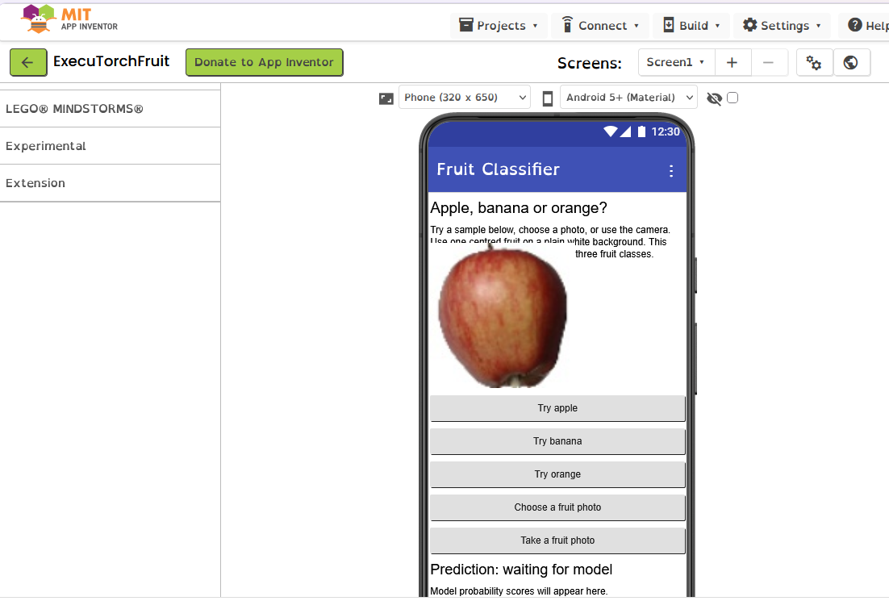
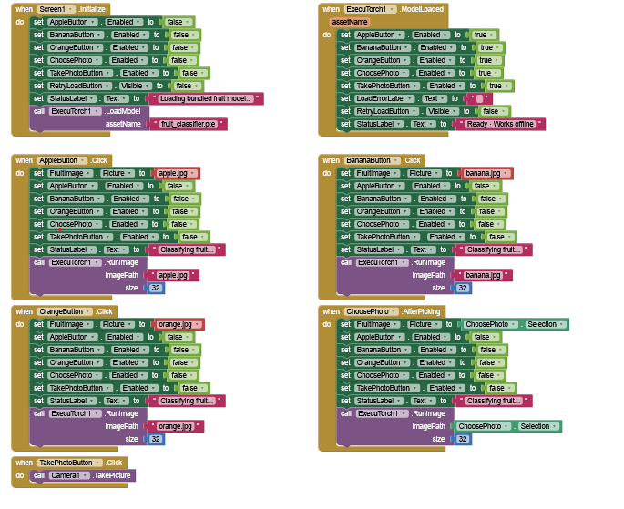

# Earlier screenshots

Screenshots from earlier versions of the fruit app, kept for reference. The layout and
blocks have changed since; follow the [main README](../README.md) for current
instructions and the [block reference](blocks.md) for the current blocks.

