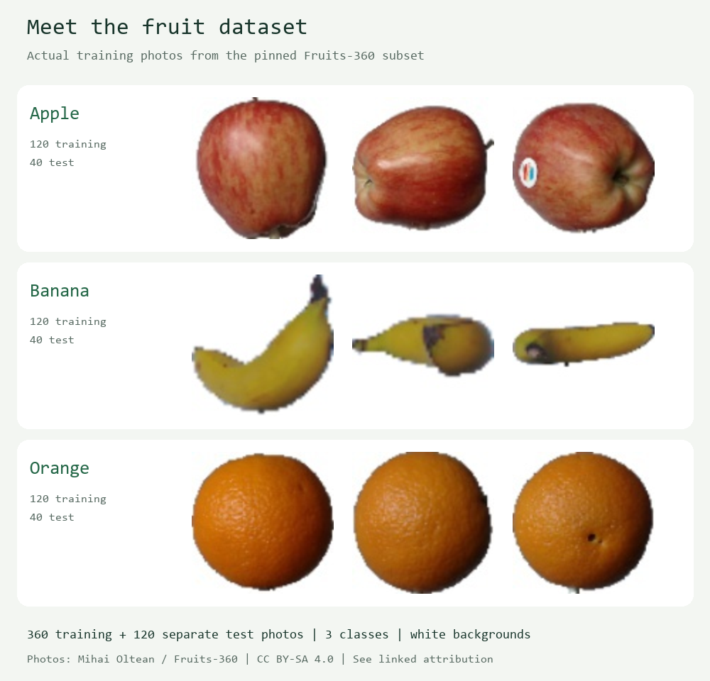
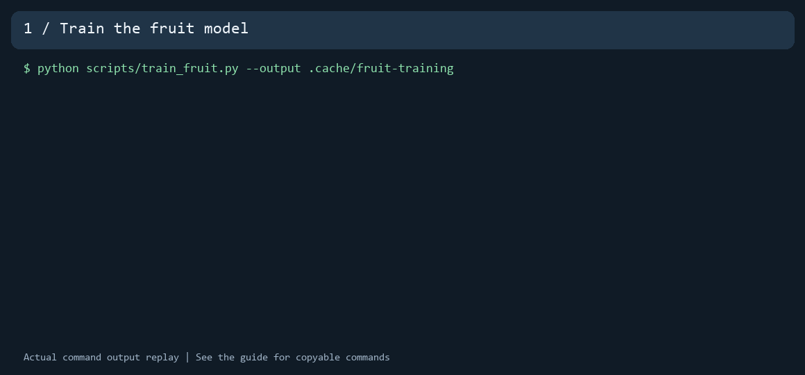
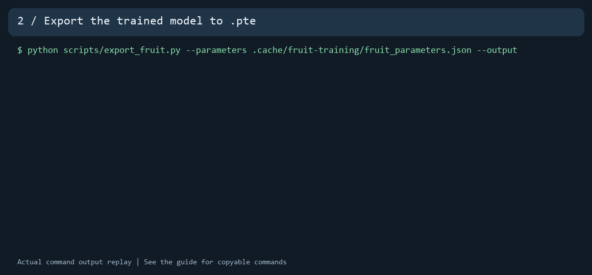

# Train a fruit model and export it to PTE

You can use the supplied app without training anything. This optional guide shows
where its model comes from and how to create your own copy on a computer.
Training learns weights; exporting packages those weights for the Android runtime.
The phone performs inference, not training.

## Dataset

This repo includes a small, pinned subset of
[Fruits-360](https://github.com/fruits-360/fruits-360-100x100), not the complete dataset.

| App label | Original dataset class | Training photos | Test photos | In the sample app |
| --- | --- | ---: | ---: | ---: |
| apple | Apple Red 1 | 120 | 40 | 1 test photo |
| banana | Banana 1 | 120 | 40 | 1 test photo |
| orange | Orange 1 | 120 | 40 | 1 test photo |
| **Total** | **3 classes** | **360** | **120** | **3 photos** |



Examples from our Fruits-360 subset: three classes photographed on white backgrounds.
The grid uses training photos; testing uses separate images. Photos: Mihai Oltean /
Fruits-360, CC BY-SA 4.0. Images were resized and arranged with labels;
[source records](images/fruit-dataset-sources.json) and [attribution](../models/FRUIT_DATASET.md).

- [Download the subset](../models/fruit_dataset.zip): contains original images,
  attribution and the manifest. Scripts verify hashes before extracting it.
- [Manifest](../models/fruit_dataset_manifest.json): source revision, file paths,
  URLs, labels and hashes for every photo. Original Test images stay in Test.
- Images are RGB, 100 by 100 pixels, with isolated fruit on simple white backgrounds.
  The model uses resized 32 by 32 RGB images.
- [Attribution and limitations](../models/FRUIT_DATASET.md): Mihai Oltean,
  CC BY-SA 4.0. Retain attribution when sharing the images or derived model.

## 1. Prepare Python

Open PowerShell or a terminal in the repository folder. Training needs Python,
NumPy, Pillow and scikit-learn. Export also needs PyTorch and ExecuTorch.
You do not need Android Studio or a GPU for these two steps.

The recorded walkthrough uses Python 3.13, NumPy 2.3.3, Pillow 12.3.0,
scikit-learn 1.8.0, PyTorch 2.8.0 CPU and ExecuTorch 1.5.1.
These are the observed environment versions, not a guarantee that every operating
system has matching wheels. Use the [official ExecuTorch setup guide](https://docs.pytorch.org/executorch/stable/getting-started.html)
for platform compatibility. The extension's Android runtime is pinned to **1.5.1**.

PowerShell (no activation or execution-policy change required):

```powershell
py -3.13 -m venv .venv
.\.venv\Scripts\python.exe -m pip install --upgrade pip
.\.venv\Scripts\python.exe -m pip install numpy==2.3.3 Pillow==12.3.0 scikit-learn==1.8.0
.\.venv\Scripts\python.exe -m pip install torch==2.8.0 --index-url https://download.pytorch.org/whl/cpu
.\.venv\Scripts\python.exe -m pip install torch==2.8.0 executorch==1.5.1
```

macOS / Linux terminal (use a supported Python installation):

```bash
python3 -m venv .venv
.venv/bin/python -m pip install --upgrade pip
.venv/bin/python -m pip install numpy==2.3.3 Pillow==12.3.0 scikit-learn==1.8.0
.venv/bin/python -m pip install torch==2.8.0 executorch==1.5.1
```

The walkthrough was recorded on Windows. If compatible export wheels are unavailable
for your platform, use the pretrained model to try the app while you resolve your
environment with the official setup documentation.

## 2. Train

PowerShell:

```powershell
.\.venv\Scripts\python.exe scripts/train_fruit.py --output .cache/fruit-training
```

Terminal:

```bash
.venv/bin/python scripts/train_fruit.py --output .cache/fruit-training
```



[Read the training transcript](tutorials/train-fruit.txt).
The GIF displays `python` for brevity; use your virtual environment's executable
as shown above. It replays real output with edited timing; it is not a live screen recording.

The command checks and extracts the bundled dataset, learns a multinomial logistic
regression classifier and writes:

- `.cache/fruit-training/fruit_parameters.json`: learned weights and biases.
- `.cache/fruit-training/training_report.json`: settings, iteration count and test accuracy.

The recorded run reached 100% on this 120-photo Test subset in 26 solver iterations.
That is accuracy on photos like the training set, not on everyday camera photos. This
is a small linear teaching model, not a pretrained neural network such as YOLO.

## Model settings and hyperparameters

A hyperparameter is a choice made before training. Weights and biases are learned
parameters. Input size and normalization are preprocessing choices; the export
version is a deployment setting. They are listed together so you can see the full recipe.

| Setting | Value | Meaning | Reference |
| --- | --- | --- | --- |
| Classifier | Multinomial logistic regression | Scores the three labels from flattened pixel values | [Classifier API](https://scikit-learn.org/1.8/modules/generated/sklearn.linear_model.LogisticRegression.html) |
| `C` | `0.1` | Inverse regularization strength; smaller values mean stronger regularization | [Regularization / C](https://scikit-learn.org/1.8/modules/generated/sklearn.linear_model.LogisticRegression.html) |
| `max_iter` | `1000` | Upper limit on solver iterations, not a promised number of epochs | [Iteration limit](https://scikit-learn.org/1.8/modules/generated/sklearn.linear_model.LogisticRegression.html) |
| `solver` | `lbfgs` | Optimization algorithm used to learn weights | [Solver choices](https://scikit-learn.org/1.8/modules/generated/sklearn.linear_model.LogisticRegression.html) |
| `tol` | `0.0001` | Stopping tolerance for convergence | [Tolerance](https://scikit-learn.org/1.8/modules/generated/sklearn.linear_model.LogisticRegression.html) |
| `random_state` | `42` | Recorded seed; `lbfgs` does not use it to shuffle training samples | [Seed behavior](https://scikit-learn.org/1.8/modules/generated/sklearn.linear_model.LogisticRegression.html) |
| Input | RGB, 32 × 32, float32 | Tensor shape `[1,3,32,32]`, red/green/blue channel planes | [Model contract](../models/fruit_contract.json) |
| Normalization | RGB /255, then ×2 −1 | App supplies `[0,1]`; scaling to `[-1,1]` stays inside the PTE | [Implementation](../scripts/export_fruit.py) |
| Output | Softmax, 3 scores | Label order: apple, banana, orange; no unknown class | [Softmax](https://docs.pytorch.org/docs/stable/generated/torch.nn.Softmax.html) |
| Export/runtime | ExecuTorch `1.5.1` | Match the Android runtime pinned by this extension | [Export and lowering](https://docs.pytorch.org/executorch/stable/using-executorch-export.html) |

To experiment, change one setting and save to a different directory:

```powershell
.\.venv\Scripts\python.exe scripts/train_fruit.py --c 1.0 --max-iter 1000 --output .cache/fruit-experiment
```

Compare the report with the baseline. Repeatedly choosing settings based on the
same Test photos makes them less useful as an independent final test. For a larger
project, introduce a validation split and keep a final test set untouched.
Learning rate, batch size and neural-network epochs are not settings used by this recipe.

## 3. Convert the trained weights to PTE

PowerShell:

```powershell
.\.venv\Scripts\python.exe scripts/export_fruit.py --parameters .cache/fruit-training/fruit_parameters.json --output .cache/fruit-export
```

Terminal:

```bash
.venv/bin/python scripts/export_fruit.py --parameters .cache/fruit-training/fruit_parameters.json --output .cache/fruit-export
```



[Read the export transcript](tutorials/export-fruit.txt).

The exporter constructs the PyTorch calculation from the saved weights, checks its
scores against a NumPy reference, captures it with `torch.export`, and converts it
through ExecuTorch's portable backend to `.pte`. It also checks that the captured
PyTorch graph matches the eager model for a sample input.
See [torch.export](https://docs.pytorch.org/docs/stable/export.html) and
[ExecuTorch export and lowering](https://docs.pytorch.org/executorch/stable/using-executorch-export.html).

Outputs include `.cache/fruit-export/fruit_classifier.pte`, `fruit_contract.json`,
sample photos and attribution. This optional export directory does not replace
the checked-in model or modify the app until you copy it deliberately.

The exporter rejects a model below 90% on this teaching subset. That guard catches
large regressions; it is not a standard of accuracy for real-world deployment.

## 4. Put the model in App Inventor

1. Import the supplied fruit `.aia` project.
2. Replace its `fruit_classifier.pte` Media asset with your exported file of the
   same name. Keep `RunImage` size 32 and the label order above.
3. Build and install a new APK. Wait for **Ready**, then test all three samples.
4. Test your own photos and record errors and score changes.

If you change labels, input shape or preprocessing, update the app blocks to match.
The extension accepts only the documented single float32 input/output tensor contract.

Maintainers can regenerate the bundled app after copying the complete exported
model, parameters, contract and sample photos into `models/`, then running
`scripts/make_fruit_example.py` and the verification scripts. Keep dataset
provenance and attribution with the model.

## Recreate these animations

In the prepared export environment, run `python scripts/make_training_gifs.py`.
It executes both commands, creates GIFs from their actual stdout and saves text
transcripts, including any diagnostic stderr. Generated models stay under `.cache/`.
The animation timing is for readability and does not measure training speed.
